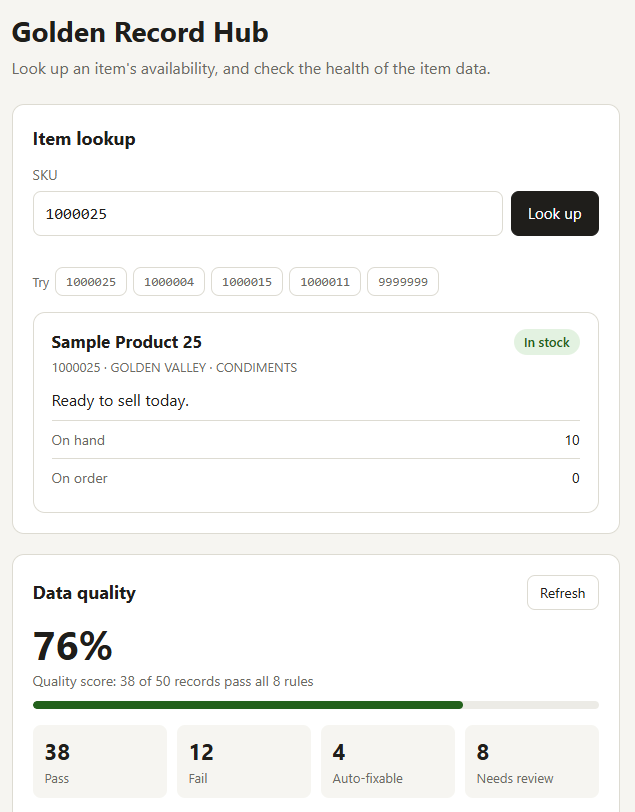

# Golden Record Hub

A small master data management (MDM) system for item data, built from scratch in JavaScript.

It checks every item record against business rules, rejects bad data at the door, scores the overall quality of the data, and gives two views of the same records: a SKU lookup for sales and a review list for a data steward.



All data in this project is synthetic. It runs locally on your own computer.

## Why I built this

I built this to learn MDM development hands-on: JavaScript, JSON, REST APIs, regular expressions, and Git, applied to the kind of item data I work with in distribution operations. I planned and built it in short sprints, the same way I'd work on a development team.

## What it does

- **Validates item data** with 8 business rules (regex format checks, duplicates, required fields, allowed values, and more).
- **Finds every planted defect.** The sample data has 50 items with 12 deliberate problems. The rules flag exactly those 12, so 38 pass and 12 fail, and no clean record is flagged.
- **Separates auto-fixable problems from ones that need a person.** 4 of the 12 have a safe automatic fix (like `northstar` → `NORTHSTAR`). The other 8 need a human decision.
- **Rejects bad data at the door.** The REST API runs every rule before saving a new item and answers `422` with a readable list of problems.
- **Scores data quality live**, with a score (76%), counts, failures by rule, and the records that need review.
- **Shows availability to sales.** Type a SKU to see In stock, On order, Needs order, or Discontinued.

## How it maps to MDM concepts

| MDM concept | In this project |
| --- | --- |
| Data model | `data-model.json`: item fields and allowed values |
| Business rules | `src/rules/data-quality-rules.js`: 8 rules, each a `check` and an optional `fix` |
| Inbound validation | `POST /items` rejects any item that breaks a rule |
| Golden record | `sample-data/items.json`: one trusted record per item |
| Data steward review | "Records to review," split into auto-fix and needs review |
| Data quality monitoring | `GET /dq/summary` and the quality panel |
| Consuming system | The SKU lookup page reads from the hub's own API |

## Running it

You need [Node.js](https://nodejs.org) (LTS version).

```bash
git clone https://github.com/ProbBobSoluDevUp/golden-record-hub.git
cd golden-record-hub
npm install
node src/server.js
```

Then open <http://localhost:3000>. Stop the server with Ctrl + C.

Other commands, run from the project folder:

| Command | What it does |
| --- | --- |
| `node scripts/run-quality-check.js` | Prints the quality report in the terminal and saves it to `reports/quality-results.json` |
| `node scripts/generate-sample-data.js` | Rebuilds the 50 sample items, resetting any you added |
| `node test-availability.js` | Tests the availability logic against `tests/availability-cases.json` |
| `node validate-model.js` | Checks `data-model.json` for problems |

## API

| Method | Path | What it does |
| --- | --- | --- |
| `GET` | `/items` | Every item |
| `GET` | `/items/:sku` | One item, or `404` if no item has that SKU |
| `POST` | `/items` | Adds an item only if it passes every rule: `201 Created`, `422` with the problems, or `400` if the request isn't one JSON object |
| `GET` | `/dq/summary` | Live quality report: score, counts, failures by rule, and records to review |

Try it with the request files in `requests/`. On Windows PowerShell, type `curl.exe` rather than `curl`.

```bash
curl -i -X POST http://localhost:3000/items -H "Content-Type: application/json" --data-binary "@requests/bad-item.json"
```

```json
{
  "error": "Item failed 4 data-quality rule(s). Nothing was saved.",
  "problems": [
    {
      "rule": "REQUIRED_FIELDS",
      "message": "Missing required field(s): productName",
      "suggestedFix": null
    },
    {
      "rule": "SKU_FORMAT",
      "message": "SKU \"52A\" must be exactly 7 digits",
      "suggestedFix": null
    }
  ]
}
```

The response above is shortened; the full one lists all 4 problems.

## The rules

| Rule | Checks that | Auto-fix |
| --- | --- | --- |
| `REQUIRED_FIELDS` | Every required field is present and not blank | No |
| `SKU_FORMAT` | The SKU is exactly 7 digits (`/^\d{7}$/`) | No |
| `DUPLICATE_SKU` | No two records share a SKU | No |
| `ALLOWED_VALUES` | Status, category, and brand come from their allowed lists | Yes, when uppercasing fixes it |
| `NO_EXTRA_SPACES` | Text fields have no leading, trailing, or doubled spaces | Yes |
| `PACK_SIZE_FORMAT` | Pack sizes in names have no spaces around the slash (`12 / 1` → `12/1`) | Yes |
| `QUANTITY_VALID` | Quantities are whole numbers, 0 or more | No |
| `AVAILABILITY_MATCHES` | The stored availability status matches what the quantities say | Yes, by recalculating it |

Fixes are suggested in the report, not applied automatically. Applying them is on the roadmap.

## Availability statuses

| Status | Meaning |
| --- | --- |
| `IN_STOCK` | Stock on hand, ready to sell |
| `ON_ORDER` | None on hand, more on order |
| `NEEDS_ORDER` | Nothing on hand or on order |
| `DISCONTINUED` | No longer sold |

The hub always calculates the status from the item's status and quantities (`src/rules/availability-status.js`). A value sent in by another system is ignored.

In a real system, on-hand and on-order quantities would come from an ERP as transactional data. This demo keeps them on the item record for simplicity.

## Design decisions

- **One quality engine.** `src/quality.js` runs the rules for both the API and the terminal report, so they always agree.
- **Calculated fields are calculated.** `availabilityStatus` is always derived by the hub, never accepted from a sender.
- **Validate before saving.** A rejected item never reaches the data file. `400` means the request itself was broken; `422` means the request was fine but the item broke business rules.
- **Data is shown as text, never as code.** The page builds everything with `textContent` rather than `innerHTML`, so nothing stored in a record can run on the page.
- **Plain tools.** Node.js and Express on the server; plain HTML, CSS, and JavaScript in the browser. No front-end framework and no build step.

## Project structure

```
golden-record-hub/
├── data-model.json             item fields and allowed values
├── sample-data/items.json      50 synthetic items (12 with planted problems)
├── requests/                   example good and bad items for POST /items
├── reports/                    saved output of the terminal quality report
├── scripts/
│   ├── generate-sample-data.js
│   └── run-quality-check.js
├── src/
│   ├── rules/
│   │   ├── availability-status.js
│   │   └── data-quality-rules.js
│   ├── quality.js              runs the rules and builds the report
│   └── server.js               Express API and page server
├── public/                     browser page: index.html, styles.css, app.js
└── tests/availability-cases.json
```

## Build log

| Sprint | Finished | Delivered |
| --- | --- | --- |
| 1: Data and rules | Oct 24, 2026 | Data model, 50 sample items, 8 rules, quality report (38 pass / 12 fail) |
| 2: REST API | Oct 27, 2026 | `GET /items`, `GET /items/:sku`, `POST /items` with `422` validation, `GET /dq/summary` |
| 3: Browser page | Oct 28, 2026 | SKU lookup and data-quality panel |

## Roadmap

- **Review workflow:** fix and approve records in the browser, with a status history for each record
- **Apply auto-fixes** with one click, and keep a record of what changed
- **Match and merge:** combine duplicate records into a single golden record
- **SQLite storage** in place of the JSON file
- **XML integration:** import a supplier XML catalog, and export SAP-style material master XML
- **Outbound feeds:** a change-only JSON feed for a web store
- **Arrival dates** for on-order items, from a mock ERP
- **Automated test suite** with Node's built-in test runner

## Built with

Node.js · Express · HTML · CSS · JavaScript · Git and GitHub

Built by Mike Wells.